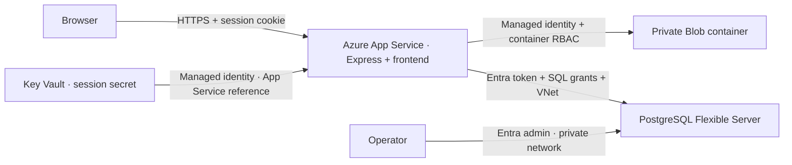

# Azure training deployment

## Architecture



Bicep creates a Linux B1 App Service plan with one instance, PostgreSQL 17 B1ms with Entra-only authentication and private VNet access, a storage account with anonymous blobs/shared keys disabled, and an RBAC Key Vault. Change SKUs/region if unavailable. These are billable resources; review your subscription's calculator before deploying. This walkthrough does not automatically deploy anything.

Runtime identity is system-assigned. Storage uses `ManagedIdentityCredential` with a **Storage Blob Data Contributor** assignment scoped to `uploads`. PostgreSQL receives a fresh Entra token for every new pooled connection, verifies TLS, and maps the identity to a restricted database role. App Service resolves `SESSION_SECRET` from a Key Vault reference; the identity has **Key Vault Secrets User** scoped to that secret. No storage account keys or database passwords are used in Azure.

## 1. Provision

Install Azure CLI with Bicep, PostgreSQL client tools, Node.js, and zip. Sign in as an operator who can create resources and role assignments. Choose a resource group dedicated to this lab. Use a 3–10 character lowercase alphanumeric prefix so the derived storage name stays below 24 characters.

```sh
az login
az account set --subscription '<subscription-id>'
az group create --name dropbox-lab --location westeurope
az bicep build --file infra/main.bicep
```

Generate a secret without putting it in shell history or a tracked file. The secure ARM parameter is hidden from deployment output. A short-lived parameter file is created with restrictive permissions and deleted afterward; keep it outside the checkout.

```sh
umask 077
params_file=$(mktemp)
node --input-type=module -e '
  import { randomBytes } from "node:crypto";
  console.log(JSON.stringify({sessionSecret:{value:randomBytes(48).toString("hex")}}));
' > "$params_file"
az deployment group create --resource-group dropbox-lab --name dropbox \
  --template-file infra/main.bicep \
  --parameters @"$params_file" prefix='<unique-prefix>' \
    entraAdminObjectId='<operator-object-id>' entraAdminName='<operator-UPN-or-group-name>'
rm -f "$params_file"
az deployment group show --resource-group dropbox-lab --name dropbox --query properties.outputs
```

The default administrator type is `User`. For a group or service principal, supply `entraAdminType=Group` or `entraAdminType=ServicePrincipal`.

Keep the returned app name, host, and identity object ID. RBAC propagation and Key Vault reference refresh can take time; inspect the reference status in App Service Configuration if startup reports an unresolved secret. Restart after the database bootstrap below.

## 2. Bootstrap PostgreSQL as the operator

The database has **no public endpoint**. Run these commands from an operator workstation with VPN/peering into the VNet, or a temporary administration VM attached to a separate subnet in that VNet, with the repository and `psql` available. Azure Cloud Shell without VNet connectivity cannot reach it. The template does not create a VM or VPN. Do not open a blanket database firewall rule to work around this boundary.

Sign in as the configured Entra operator, then:

```sh
export PGHOST='<postgresHost output>' PGPORT=5432 PGSSLMODE=verify-full
export PGUSER='<operator-UPN-or-Entra-group-name>'
export PGPASSWORD="$(az account get-access-token \
  --resource https://ossrdbms-aad.database.windows.net --query accessToken -o tsv)"
psql -d postgres -v app_object_id='<managedIdentityObjectId output>' -f infra/bootstrap.sql
unset PGPASSWORD
```

Ensure the PostgreSQL client trusts Azure's certificate chain (`PGSSLROOTCERT` may be needed for your client installation). `bootstrap.sql` creates the identity mapping, switches to `dropbox`, applies the schema, and grants table/column permissions. Run it once; on later deployments apply `sql/001-initial.sql` and grants without recreating the principal. Future migrations also run as the operator.

The app has `SELECT` and restricted registration `INSERT` on users, `SELECT/INSERT` on files, and session CRUD. It has no role update, schema creation, or migration privileges. Application-level admins are ordinary database rows, distinct from the Entra operator and Azure RBAC.

## 3. Build and deploy the app

Run locally after dependency installation and checks:

```sh
npm install
npm run typecheck
npm run lint
npm run build
bash scripts/package.sh
az webapp deploy --resource-group dropbox-lab --name '<appName output>' \
  --src-path app.zip --type zip
az webapp restart --resource-group dropbox-lab --name '<appName output>'
```

The archive uses an explicit source allowlist and excludes `.env`, uploads, and local database data. App Service/Oryx installs dependencies and runs `npm run build`; `npm start` serves the API and bundled frontend. Deployment uses Azure CLI/Entra authorization; basic SCM/FTP publishing credentials are disabled. Do not set `WEBSITE_RUN_FROM_PACKAGE` with this remote-build workflow.

Open the returned `appUrl` and register your account. For a custom domain, update `APP_ORIGIN` to its exact HTTPS origin before using it. Express trusts one ingress proxy; do not expose its Node port directly outside App Service.

As the Entra operator on the private network, connect to the `dropbox` database and grant app admin:

```sql
UPDATE users SET role = 'admin' WHERE email = 'you@example.com';
-- To revoke:
UPDATE users SET role = 'user' WHERE email = 'you@example.com';
```

Sign out and back in to refresh navigation. Backend role enforcement changes on the next request, including for existing sessions.

## 4. Verify the lab

- `/api/health` reports database connectivity. Verify a real upload/download as well; health does not test Blob permissions.
- Create two accounts. Confirm cross-account downloads return 404 and ordinary users get 403 for admin lists. Repeat a cross-account download as admin.
- Confirm `allowSharedKeyAccess=false`, anonymous container access is disabled, PostgreSQL password authentication is disabled, and the app identity is not database admin.
- Review permissions and attack exercises in [SECURITY.md](SECURITY.md). Keep one instance until rate limits use shared storage.

Storage and Key Vault retain publicly reachable service endpoints with identity enforcement. PostgreSQL is private. Restrict inbound App Service access to your training audience if registration should not be internet-accessible. Storage private endpoints, malware scanning, and centralized audit logging are useful follow-up exercises.

## Cleanup and references

Delete the dedicated resource group when finished: `az group delete --name dropbox-lab`. This removes lab data. Key Vault purge protection retains the deleted vault until its retention period expires; use a different prefix when recreating it.

Implementation references: [Blob SDK identity authentication](https://learn.microsoft.com/en-us/javascript/api/overview/azure/storage-blob-readme), [PostgreSQL managed identity](https://learn.microsoft.com/en-us/azure/postgresql/flexible-server/security-connect-with-managed-identity), [Entra database principals](https://learn.microsoft.com/en-us/azure/postgresql/security/security-manage-entra-users), [App Service Key Vault references](https://learn.microsoft.com/en-us/azure/app-service/app-service-key-vault-references).
